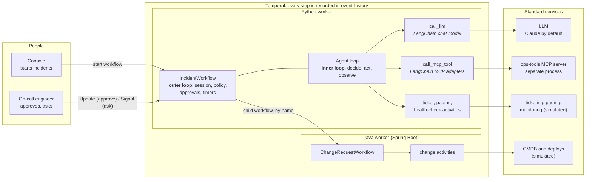

# Durable incident copilot

**An AI agent built with LangChain and MCP, running on Temporal, using Claude or any LangChain-supported LLM.** Start an incident, watch the agent investigate and fix it, then break things on purpose (kill the worker, take down a tool server, ship a bug) and watch it recover without losing its place.

> **Temporal runs the outer loop. LangChain runs each agent turn.**
>
> The Temporal workflow owns the session: the conversation, every tool result, policy, human approvals, timers, and calls into other services. LangChain does the work inside each model call: it formats messages, binds tools, calls the model, and adapts MCP tools. When anything fails, Temporal retries the step or rebuilds the session from its event history.

This is a demo for learning, not production code. Everything runs on your machine, and the incident data, ticketing, paging, monitoring, and CMDB are simulated.

## Contents

- [What you'll see](#what-youll-see)
- [Quick start](#quick-start)
- [Prerequisites](#prerequisites)
- [How it works](#how-it-works)
- [Using the console](#using-the-console)
- [Scenarios](#scenarios)
- [Running options](#running-options), including [choosing an LLM](#choosing-an-llm) and [your own Temporal service](#connecting-to-your-own-temporal-service)
- [Configuration](#configuration)
- [Command reference](#command-reference)
- [Tests](#tests)
- [Troubleshooting](#troubleshooting)
- [Project layout](#project-layout)
- [Security notes](#security-notes)
- [Further reading](#further-reading)

## What you'll see

| Capability | Where it shows up |
|---|---|
| LangChain inside Temporal activities | Every model decision is a `call_llm` activity using a LangChain chat model (`ChatAnthropic` by default) with bound tools |
| Bring your own LLM | Claude by default; OpenAI, Azure OpenAI, Bedrock, Gemini, Ollama, or any OpenAI-compatible server through configuration |
| MCP integration | The agent discovers tools from a separate MCP server at run time, through LangChain's MCP adapters |
| Tools as Temporal activities | Ticketing and paging tools are activities, with retries, timeouts, and an audit trail |
| Human in the loop | Risky changes wait for approval, sent as a validated Temporal Update |
| Long-running, durable sessions | Sessions wait for people and timers at no cost, and accept follow-up questions for hours |
| Automatic retries | A tool server fails four times and succeeds on the fifth; the agent never notices |
| Recovering from a code bug | A bug stalls a workflow; fix the code, restart the worker, and it resumes where it stopped |
| Unrecoverable failures | A non-retryable error from a Java service triggers compensation, then fails the workflow cleanly |
| Local, self-hosted, or Cloud Temporal | The same code runs on the local dev server, your own Temporal service, or Temporal Cloud |
| Polyglot workers | A Python workflow calls a Java (Spring Boot) workflow by name; they share only a JSON contract |
| Advanced Visibility | Each run updates search attributes, so you can query incidents by phase, service, or approval status |
| Short and long workflows | A seconds-long triage workflow next to a session that can live for days |

## Quick start

```bash
cd temporal-langchain-incident-demo
make setup        # installs dependencies and creates .env
```

Optionally, add an LLM key to `.env`: `ANTHROPIC_API_KEY=...` for the default (Claude), or see [Choosing an LLM](#choosing-an-llm) for other providers. Without one, choose **Scripted** in the console. Scripted mode replaces only the model with a deterministic script; Temporal, MCP, and Java stay real.

```bash
make up           # starts all six processes, checks them, and stays running; Ctrl-C stops everything
```

Open **<http://localhost:5173>**, click **Run** next to **Happy path**, and watch. Then follow the guided tour in **[docs/demo-script.md](docs/demo-script.md)**, which walks through every scenario and what it teaches.

The Temporal UI is at **<http://localhost:8233>**. Every step you see in the console is also there, in the workflow's event history.

## Prerequisites

| Tool | Version | Check | Install |
|---|---|---|---|
| Temporal CLI | 1.x | `temporal --version` | macOS: `brew install temporal`. Others: [docs.temporal.io/cli](https://docs.temporal.io/cli) |
| uv (Python package manager) | recent | `uv --version` | [docs.astral.sh/uv](https://docs.astral.sh/uv/) |
| Python | 3.11 or newer | `python3 --version` | uv can install it: `uv python install 3.12` |
| Node.js | 20 or newer | `node --version` | [nodejs.org](https://nodejs.org) |
| Java | 17 or newer | `java -version` | Any OpenJDK, for example [Adoptium](https://adoptium.net) |
| Maven | 3.9 or newer | `mvn -v` | macOS: `brew install maven`. Others: [maven.apache.org](https://maven.apache.org) |
| make, curl | any | `make -v` | Included with macOS developer tools and most Linux distributions |
| An LLM | optional | | Claude by default ([console.anthropic.com](https://console.anthropic.com)), or [another provider](#choosing-an-llm). Not needed for Scripted mode |

The first `make setup` downloads Python, Node, and Maven dependencies, so it takes a few minutes. The first run of the Java worker also compiles it.

## How it works

### The idea: an outer loop and an inner loop

An agent is a loop: the model decides what to do, a tool runs, the result goes back to the model, and so on. Agent frameworks like LangChain make each step easy to write. But a real session also has to survive crashes, retry flaky services, wait hours for a person, and talk to systems owned by other teams. That's the job of the **outer loop**, and it's what Temporal provides.

- **Inner loop (the agent turn):** the model decides what to do next, through LangChain. Each decision is one Temporal activity, and each tool call is another.
- **Outer loop (the session):** the `IncidentWorkflow` owns the conversation and everything around it: change policy, approvals, the call into the Java change system, verification timers, and follow-up questions.

Because every step is an activity whose result is recorded in event history, a crash between any two steps loses nothing. A new worker replays the history, rebuilds the conversation, and continues from the next step without calling the model again for decisions it already made.

### Architecture



### Components, and why each one is here

| Component | Built with | What it does | Why it's designed this way |
|---|---|---|---|
| `IncidentWorkflow` | Temporal Python SDK | The outer loop: owns the session, applies change policy, waits for approval, starts the Java change, runs verification timers, answers follow-ups | Workflow state is rebuilt from history after any failure, so the session can't be lost. Waiting on people or timers holds no thread |
| `TriageWorkflow` | Temporal Python SDK | A short, read-only version of the agent that finishes in seconds | Shows that short and long workflows use the same programming model |
| Agent loop | Workflow code (`AgentLoop`) | Runs one agent turn: call the model, run the tools it chose, repeat until it replies | Each decision and each tool call is a separate activity, so every step is retried independently and visible in history |
| `call_llm` activity | A LangChain chat model (`ChatAnthropic` by default, any provider via `init_chat_model`) | Converts the conversation to LangChain messages, binds tool schemas, calls the model, returns its decision | LangChain handles the model interface. Running it in an activity gives it timeouts and retries, and keeps LangChain out of deterministic workflow code |
| MCP activities | `langchain-mcp-adapters` | Discover the MCP server's tools, then call the ones the model picks | Tool discovery is recorded, so replays see the same tools. An MCP outage is just a retry |
| Tool activities | Plain Python | Open tickets, add notes, page on-call, check health | Tools you own get durability for free and leave an audit trail (`make journal`) |
| ops-tools MCP server | Official MCP Python SDK (FastMCP), streamable HTTP | Serves service info, metrics, logs, and deploy history, with a fault-injection endpoint | A separate process plays the part of someone else's system. The agent has no compile-time knowledge of its tools |
| `ChangeRequestWorkflow` | Temporal Java SDK, Spring Boot starter | Validates a change against a stand-in CMDB and executes it step by step | Shows that teams can use whichever SDK fits. Python starts it by name on another task queue; the only shared thing is a JSON contract |
| Console and API | React, React Flow, FastAPI | Starts runs, sends approvals and questions, and draws what's happening | Everything on screen is derived from Temporal's event history, so what you see is what actually ran |
| The LLM | Claude by default | Reasons about the incident and chooses tools | Configuration, not code: set `LLM_PROVIDER` and `LLM_MODEL` (see [Choosing an LLM](#choosing-an-llm)). Workflows never know which model is used |

Why the agent loop is written explicitly rather than with a graph framework, how the Python-to-Java contract works, and the full failure semantics: see [docs/architecture.md](docs/architecture.md).

## Using the console

The console at <http://localhost:5173> has four areas.

**Left rail.** Choose the model (your configured LLM, shown by name, or **Scripted**), start any scenario with **Run**, start a short triage workflow (**Short workflow**, then **Run triage**), open prebuilt Advanced Visibility queries in the Temporal UI, and pick from recent runs. **Close open sessions** asks every running session to finish.

**Architecture graph.** Three regions, left to right:

- **People**
- **Temporal**: workflows on the left, activities on the right
- **Standard services**

Green **LangChain** badges mark the activities LangChain runs inside. Nodes and connections light up as steps run. A retrying activity turns orange, and the service it calls turns red.

**Execution, step by step.** A sequence diagram of the selected run. Each row is one event from Temporal's history. Arrows run from the workflow to an activity, from the activity to its service, and back. Frames show the structure:

- **`loop`** is one agent turn (the inner loop).
- **`par`** marks tool calls that ran in parallel.
- **`tool`** is workflow code serving a tool call (approval, the Java change, verification).

Select any row to see the exact input and result Temporal recorded.

**Session and step details.** The conversation as the workflow holds it, where you can ask follow-up questions. Next to it are the approval card (when a decision is pending) and the details of the selected step.

The page never scrolls on its own. Panels follow their newest entry only while you're at their bottom; untick **Follow new steps** to freeze the step-by-step panel.

## Scenarios

Each scenario is one click in the console. The [guided tour](docs/demo-script.md) explains what to look for in each.

| Scenario | Service | What happens | Temporal feature |
|---|---|---|---|
| Happy path | checkout-api | The agent investigates over MCP, restarts the service through Java, and verifies with durable timers | Activities, cross-language child workflow, timers |
| Human approval | payments-api | The agent proposes a rollback, which waits for approve or reject | Validated Update, durable wait with a deadline |
| API downtime | inventory-api | The MCP metrics tool fails four times, then succeeds on attempt five | Activity retry policy |
| Bug in workflow code | search-api | A deliberate exception stalls the workflow; comment it out, restart the worker, and it resumes | Workflow task retry, replay |
| Unrecoverable failure | legacy-billing | Java rejects the change; Python compensates, then fails | Non-retryable errors across languages, compensation |
| Long-running session | orders-api | A two-minute verification window; kill the worker mid-run, restart it, ask a follow-up | Durable execution, long-lived sessions |
| Quick triage | your choice | A read-only agent turn that finishes in seconds | Short workflows |

With a live model, the exact tools and wording vary from run to run, which is expected: Temporal records whatever the model decided. Scripted mode is deterministic.

## Running options

### One terminal (recommended)

| Command | What it does |
|---|---|
| `make up` | Starts all six processes, waits for each one, runs the preflight check, and stays running. Ctrl-C (or closing the terminal) stops everything it started |
| `make up-demo` | Same, but leaves out the Python worker. Run `make worker` in a second terminal so you can kill and restart it for the crash scenario |
| `scripts/start-all.sh --skip <name>` | Leave out any service: `temporal`, `mcp`, `java`, `worker`, `api`, or `ui` |
| `scripts/start-all.sh --follow` | Stream every log in this terminal, prefixed by service name |
| `scripts/start-all.sh --no-doctor` | Skip the preflight check |
| `UI_PORT=5180 make up` | Serve the console on another port |

Logs are written to `.logs/<name>.log`. If one of the services is already running, it's left alone. If another program holds one of the ports, the launcher says so and shows which process.

### Separate terminals

Start each in its own terminal, in this order, then run `make doctor`:

```bash
make temporal   # Temporal dev server with the custom search attributes (UI on :8233)
make mcp        # MCP server on :8765
make java       # Java change-management worker (HTTP on :8081)
make worker     # Python worker
make api        # console API on :8000
make ui         # console on :5173
```

If you use tmux, `scripts/start-all-tmux.sh` opens one window per process instead.

### Choosing an LLM

Choose per run in the console: your configured LLM (shown by name) or **Scripted**.

- **Scripted** needs no key and makes no API calls. It follows the runbook using the real MCP results, so it's ideal for learning the Temporal side, for offline use, and for tests.
- **A live model** is whatever `LLM_PROVIDER` and `LLM_MODEL` name in `.env`. Anthropic goes through `ChatAnthropic`; every other provider goes through LangChain's [`init_chat_model`](https://docs.langchain.com), so anything LangChain supports works, as long as the model **supports tool calling**. Workflows, activities, and the console don't change.

To switch providers, edit `.env`, then run `make setup` (which installs that provider's LangChain package) and restart the worker:

| Provider | `.env` settings | LangChain package |
|---|---|---|
| Anthropic (default) | `LLM_PROVIDER=anthropic`, `LLM_MODEL=claude-sonnet-5-5`, `ANTHROPIC_API_KEY` | `langchain-anthropic` (always installed) |
| OpenAI | `LLM_PROVIDER=openai`, `LLM_MODEL=<model>`, `OPENAI_API_KEY` | `langchain-openai` |
| Azure OpenAI | `LLM_PROVIDER=azure_openai`, `LLM_MODEL=<model>`, `AZURE_OPENAI_API_KEY`, `AZURE_OPENAI_ENDPOINT`, `OPENAI_API_VERSION`, `LLM_KWARGS='{"azure_deployment": "<name>"}'` | `langchain-openai` |
| OpenAI-compatible server (vLLM, LM Studio, LiteLLM, ...) | `LLM_PROVIDER=openai`, `LLM_MODEL=<model>`, `LLM_BASE_URL=http://host:port/v1`, `OPENAI_API_KEY` (any value if unchecked) | `langchain-openai` |
| Ollama (local) | `LLM_PROVIDER=ollama`, `LLM_MODEL=<model>`, optionally `LLM_BASE_URL` | `langchain-ollama` |
| Amazon Bedrock | `LLM_PROVIDER=bedrock_converse`, `LLM_MODEL=<model id>`, your usual AWS credentials and region | `langchain-aws` |
| Google Gemini | `LLM_PROVIDER=google_genai`, `LLM_MODEL=<model>`, `GOOGLE_API_KEY` | `langchain-google-genai` |
| Mistral, Groq | `LLM_PROVIDER=mistralai` or `groq`, `LLM_MODEL`, `MISTRAL_API_KEY` or `GROQ_API_KEY` | `langchain-mistralai`, `langchain-groq` |
| Anything else `init_chat_model` supports | `LLM_PROVIDER=<provider>`, `LLM_MODEL`, the provider's own credentials | install it: `cd python && uv add <package>` |

`LLM_KWARGS` passes any extra keyword arguments to the chat model, as JSON in single quotes. `make doctor-live` makes one real call to confirm everything is wired up.

Things to know when switching:

- **Prompts:** the runbook prompts (`python/src/incident_agent/shared/prompts.py`) were written with Claude. Other capable models follow them well; small local models may struggle with multi-step tool calling.
- **Retries:** Temporal owns them. LangChain's retries are switched off for providers that expose that setting, and errors are classified by HTTP status, so rate limits and 5xx responses are retried while bad keys and bad requests fail fast.
- **Cost:** each run makes a handful of model calls. The console, and the `LlmTokens` search attribute, show the exact token count.

### Connecting to your own Temporal service

The same code runs on the local dev server, a self-hosted Temporal service, or Temporal Cloud. Point `TEMPORAL_ADDRESS` somewhere other than localhost and `make up` stops starting a local dev server; everything else connects to yours. Both the Python processes and the Java worker read the same `.env`.

| Your Temporal service | `.env` settings |
|---|---|
| Local dev server (default) | nothing to change |
| Self-hosted, no TLS | `TEMPORAL_ADDRESS=host:7233`, `TEMPORAL_NAMESPACE`, `TEMPORAL_UI_URL` |
| Self-hosted, TLS with a private CA | add `TEMPORAL_TLS_CA=path/to/ca.pem` |
| Self-hosted, mTLS | add `TEMPORAL_TLS_CERT` and `TEMPORAL_TLS_KEY` (and `TEMPORAL_TLS_CA` for a private CA). The Java worker needs the key in PKCS#8 PEM format |
| Self-hosted, TLS with a public CA and no client certificate | add `TEMPORAL_TLS=true` (Python). For Java, use one of the options above |
| Temporal Cloud, API key | `TEMPORAL_ADDRESS=<your endpoint>`, `TEMPORAL_NAMESPACE`, `TEMPORAL_API_KEY`, `TEMPORAL_UI_URL=https://cloud.temporal.io` |
| Temporal Cloud, mTLS | `TEMPORAL_ADDRESS`, `TEMPORAL_NAMESPACE`, `TEMPORAL_TLS_CERT`, `TEMPORAL_TLS_KEY`, `TEMPORAL_UI_URL=https://cloud.temporal.io` |

- **File paths:** relative paths are relative to `.env`.
- **Server name override:** `TEMPORAL_TLS_SERVER_NAME` overrides the name checked against the server's certificate (Python only).
- **Java profiles:** `make java` picks the right Spring profile automatically: `apikey`, `mtls`, or the private-CA configuration in `config/TemporalTlsConfig.java`.

The demo needs seven custom search attributes in the namespace:

- **Local dev server:** `make temporal` creates them.
- **Self-hosted:** `make doctor` registers any that are missing.
- **Temporal Cloud:** create them in the Cloud UI or with `tcld`. They are `IncidentService`, `IncidentSeverity`, `DemoScenario`, `AgentPhase`, `ApprovalStatus`, and `RemediationAction` (all Keyword), plus `LlmTokens` (Int).

Then start everything: `make up` (it skips the local dev server for you) and `make doctor`.

### Several runs at once, and cleaning up

Each run is its own workflow with its own ID, so you can start a scenario while another is still open. Incident sessions stay open for follow-up questions and close themselves after an idle timeout (30 minutes, or 2 hours for the long-running scenario).

| To... | Do this |
|---|---|
| Close all open sessions | **Close open sessions** in the console |
| Terminate every running incident (for example, before changing workflow code) | `temporal workflow terminate --query 'WorkflowType = "IncidentWorkflow" AND ExecutionStatus = "Running"' --reason cleanup --yes` |
| Start over with an empty history | Stop everything, then `make temporal-fresh` |
| Remove build output, logs, and the side-effects journal | `make clean` |

A running workflow replays on the new code when its worker restarts. So before changing workflow code (other than the deliberate bug line), finish or terminate open sessions.

## Configuration

Python processes read `.env` from the repository root; `make setup` creates it from `.env.example`.

| Variable | Default | Purpose |
|---|---|---|
| `LLM_PROVIDER` | `anthropic` | Any provider LangChain's `init_chat_model` supports (see [Choosing an LLM](#choosing-an-llm)) |
| `LLM_MODEL` | `claude-sonnet-5-5` for Anthropic | Model name for that provider |
| Provider credentials | none | For example `ANTHROPIC_API_KEY` or `OPENAI_API_KEY`; whatever your provider uses |
| `LLM_BASE_URL` | unset | Custom endpoint: OpenAI-compatible servers, a remote Ollama |
| `LLM_MAX_TOKENS` | `1500` | Maximum output tokens per model call |
| `LLM_TEMPERATURE` | unset | Leave unset to use the model's default; some models reject other values |
| `LLM_KWARGS` | unset | Extra chat-model keyword arguments as JSON, in single quotes |
| `LLM_MODE` | `live` | Console default: `live` (your LLM) or `mock` (Scripted) |
| `TEMPORAL_ADDRESS` | `localhost:7233` | Temporal frontend. Anything but localhost skips the local dev server |
| `TEMPORAL_NAMESPACE` | `default` | Namespace |
| `TEMPORAL_UI_URL` | `http://localhost:8233` | Used for links from the console |
| `TEMPORAL_API_KEY` | none | API key (Temporal Cloud) |
| `TEMPORAL_TLS_CERT`, `TEMPORAL_TLS_KEY` | none | mTLS client certificate and key (file paths) |
| `TEMPORAL_TLS_CA` | none | CA certificate for a self-hosted server with a private CA |
| `TEMPORAL_TLS` | unset | `true` for TLS with a public CA and no client certificate |
| `TEMPORAL_TLS_SERVER_NAME` | unset | Override the server name checked against its certificate (Python) |
| `MCP_BASE_URL` | `http://localhost:8765` | Where the agent finds the MCP server |
| `API_HOST`, `API_PORT` | `127.0.0.1`, `8000` | Console API bind address |
| `DEMO_DATA_DIR` | `.demo-data` (under `python/`) | Where the side-effects journal is written |
| `CORS_ORIGINS` | unset | Only if you serve the console from another origin than the API: comma-separated allowed origins |

Set these in the shell rather than `.env`:

- `UI_PORT`: console port, default 5173.
- `API_URL`: where the console's proxy sends API calls, if you change `API_PORT`.
- `VITE_API_BASE`: only for a console built and served separately from the API; its full URL (also set `CORS_ORIGINS` on the API side).
- `MCP_HOST` and `MCP_PORT`: MCP server bind address and port.
- `JAVA_WORKER_HOST` and `JAVA_WORKER_PORT`: the Java worker's HTTP address.

## Command reference

| Make target | What it does |
|---|---|
| `make setup` | Create `.env` and install all dependencies |
| `make up`, `make up-demo` | Start everything from one terminal (see [Running options](#running-options)) |
| `make temporal`, `mcp`, `java`, `worker`, `api`, `ui` | Start one process |
| `make doctor` | Check Temporal, search attributes, both workers, the MCP server, and the API key; registers missing search attributes |
| `make doctor-live` | Same, plus one real call to your LLM |
| `make journal` | Watch side effects (tickets, pages, health checks) as they happen |
| `make faults`, `make reset-faults` | Show or clear injected MCP faults |
| `make test` | Run the Python tests |
| `make temporal-fresh` | Delete the local Temporal database and start fresh |
| `make clean` | Remove build output, logs, and demo data |
| `make help` | List every target |

Useful Temporal CLI commands (replace `<id>` with a workflow ID from the console):

```bash
temporal workflow list --query 'AgentPhase = "AwaitingApproval"'
temporal workflow query  --workflow-id <id> --name get_state
temporal workflow update execute --workflow-id <id> --name submit_approval \
    --input '{"approved": true, "reviewer": "alice", "comment": "looks right"}'
temporal workflow signal --workflow-id <id> --name send_message --input '"What was the root cause?"'
temporal workflow show   --workflow-id <id>
```

## Tests

```bash
make test
```

- **Unit tests:** cover the scripted model and the step-annotation logic.
- **Workflow tests:** run against a local Temporal dev server, which the SDK downloads on first use. One test registers a Python stand-in for the Java `ChangeRequestWorkflow` on the same task queue, so it doubles as a contract test between the two languages.

## Troubleshooting

| Symptom | Fix |
|---|---|
| `make up` reports a service as FAILED or TIMEOUT | Read `.logs/<name>.log`. The Java worker's first run downloads Maven dependencies and can take a few minutes |
| `make up` reports a port as BLOCKED | Another program holds it; the launcher shows its PID. Stop it, or for the console use `UI_PORT=5180 make up` |
| The console URL shows a 404 or another app | Something else is on that port: `lsof -nP -iTCP:5173 -sTCP:LISTEN` |
| Starting a run fails with "search attribute ... not defined" | `make doctor` registers them, or `make temporal-fresh` |
| A run sits at "Investigating" and nothing happens | The Python worker isn't running, or is pointed at another namespace. Run `make doctor` |
| `ChangeRequestWorkflow` never starts | The Java worker isn't polling `change-management`. Check `.logs/java.log` |
| API downtime shows no retries | The MCP server wasn't reachable when the run started. Check `make faults` |
| A run fails with `LlmConfigError` | The provider's credentials or package are missing; the error says which. Set them and run `make setup`, or use Scripted |
| A run fails with `LlmBadRequest` | The provider rejected the request. Check `LLM_MODEL` is available to your account and supports tool calling, and leave `LLM_TEMPERATURE` unset |
| A run fails with `LlmAuthError` | The provider rejected your API key |
| Worker logs a TLS or certificate error | Check the TLS settings in [Connecting to your own Temporal service](#connecting-to-your-own-temporal-service); relative paths are relative to `.env` |
| The bug scenario no longer fails | The bug line is still commented out. `git checkout python/src/incident_agent/workflows/incident.py`, then restart the worker |
| The dev server won't start after changing search attribute types | `make temporal-fresh` |
| `tmux: command not found` | Use `make up`, or install tmux |

## Project layout

```text
.
├── README.md                 you are here
├── LICENSE                   MIT
├── Makefile                  every command (make help)
├── .env.example              configuration template
├── scripts/                  start-all.sh (one terminal), start-all-tmux.sh
├── docs/
│   ├── demo-script.md        guided tour of every scenario
│   ├── architecture.md       design, contracts, failure semantics
│   └── extending.md          add tools, swap models, LangGraph, MCP on Temporal
├── python/                   agent workflows, activities, console API   (python/README.md)
├── mcp-server/               ops-tools MCP server                       (mcp-server/README.md)
├── java/                     Spring Boot change-management worker      (java/README.md)
└── ui/                       React console                              (ui/README.md)
```

## Security notes

This demo is meant to run on your own machine.

- **Network:** every service listens on localhost only. The console API has no authentication. The console reaches it through Vite's same-origin proxy, so CORS is off unless you list origins in `CORS_ORIGINS`. The MCP server's `/admin/faults` endpoint is unauthenticated by design, for the downtime scenario.
- **Secrets:** your API key lives in `.env`, which is git-ignored. Don't commit it.
- **Where data goes:** prompts, model responses, and tool results are stored in Temporal's event history. With the local dev server that's `.temporal/dev.db` on your machine; with Temporal Cloud it's in your Cloud namespace. To encrypt payloads, add a payload codec (see [docs/extending.md](docs/extending.md)).
- **Outbound connections:** with a live model, conversations are sent to your LLM provider (none leave your machine with a local model such as Ollama). The console also loads two fonts from Google Fonts. Nothing else leaves your machine.

## Further reading

- [docs/demo-script.md](docs/demo-script.md): the guided tour
- [docs/architecture.md](docs/architecture.md): design decisions, the Python-to-Java contract, failure semantics, and determinism rules
- [docs/extending.md](docs/extending.md): add MCP tools and activity tools, swap the model, compare with Temporal's LangGraph plugin, build an MCP server on Temporal, and production hardening
- Temporal: [docs.temporal.io](https://docs.temporal.io) and the [Python SDK guide](https://docs.temporal.io/develop/python)
- LangChain: [docs.langchain.com](https://docs.langchain.com) and the [MCP adapters reference](https://reference.langchain.com/python/langchain_mcp_adapters/)
- Model Context Protocol: [modelcontextprotocol.io](https://modelcontextprotocol.io)

## License

[MIT](LICENSE)
